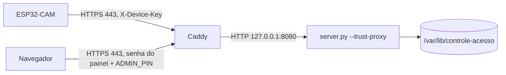

# Servidor na nuvem com HTTPS

Alternativa ao servidor no computador da LAN: o mesmo `servidor/server.py` roda numa VM (testado com Ubuntu 24.04 na AWS), atrás do **Caddy**, que tira o certificado da Let's Encrypt sozinho e fala HTTPS na porta 443. A CAM passa a mandar eventos e fotos pela internet, cifrados e com o certificado conferido.



## O que muda em relação à LAN

| item | LAN | nuvem |
|---|---|---|
| `SERVER_URL` da CAM | `http://192.168.x.x:8080` | `https://<domínio>` (sem porta) |
| transporte | HTTP em claro | TLS, raízes ISRG X1/X2 em `firmware/Esp32CamRede/ServerCA.h` |
| prazos da CAM | 0,6 s conexão, 0,9 s resposta | 5 s conexão, 5 s resposta (8 s na foto), handshake até 8 s |
| conexão | uma por pedido | um cliente TLS reaproveitado (keep-alive do Caddy) |
| painel | `ADMIN_PIN` | senha do navegador (Caddy) **e** `ADMIN_PIN` |
| limite de tentativas | por IP do peer | por IP do `X-Forwarded-For` (`--trust-proxy`) |

As rotas `/api/device/*` não pedem a senha do painel: a CAM continua só com a `X-Device-Key`. Todo o resto (página, `/api/admin/*`, fotos) pede as duas.

## Pré-requisitos

1. VM Ubuntu 24.04 com IP público e portas **80 e 443** abertas para a internet (a 80 é só para a Let's Encrypt validar o domínio). Porta 22 só para o seu IP.
2. Um nome de domínio apontando para o IP da VM. Um subdomínio grátis do DuckDNS serve.

## Instalação

Na VM:

```sh
git clone <este repositório> controle && cd controle
sudo DOMINIO=seu-nome.duckdns.org PAINEL_USUARIO=admin bash deploy/instalar.sh
```

O script instala Python e Caddy, cria o usuário de sistema `controle`, copia `servidor/` para `/opt/controle-acesso`, gera `/etc/controle-acesso.env` com `ADMIN_PIN` (10 dígitos) e `DEVICE_KEY` aleatórios, sobe o serviço `controle-acesso` e configura o Caddy. Ele pede a senha do painel uma vez. **Anote o que ele imprime**: o `DEVICE_KEY` vai para o `Config.h` da CAM e o `ADMIN_PIN` para o do Mega.

Para atualizar o código depois: `git pull` e o mesmo comando. O `.env`, a senha do painel e o banco são preservados.

## CAM

No `Config.h` da `firmware/Esp32CamRede`:

```cpp
constexpr char SERVER_URL[] = "https://seu-nome.duckdns.org";
constexpr char DEVICE_KEY[] = "<DEVICE_KEY do /etc/controle-acesso.env>";
```

O Wi-Fi da CAM precisa ter saída para a internet (NTP e 443). Certificado de outra autoridade que não a Let's Encrypt: trocar o texto de `ServerCA.h` pela raiz dela. O `Caddyfile` fixa `cert_issuer acme` para o Caddy não cair na ZeroSSL, cuja raiz a CAM não conhece.

## Operação

```sh
sudo systemctl status controle-acesso caddy
sudo journalctl -u controle-acesso -u caddy -f
sudo sqlite3 /var/lib/controle-acesso/historico.sqlite3 .dump | gzip > backup.sql.gz   # contém fotos
```

## Limites

- O servidor continua de **um aparelho só** (`DEVICE_ID`) e com SQLite local; isto é hospedagem do protótipo, não a integração com o sistema do hospital.
- A UART entre Mega e CAM continua sem autenticação, como na LAN.
- Validado em 07/11/2026 com Caddy local (`tls internal`): CAM sem senha do painel = 200, painel sem senha = 401, senha sem PIN = 401, senha + PIN = 200. **Ainda não validado com a CAM real em HTTPS**; o handshake TLS com câmera ligada depende de heap e deve ser conferido no monitor serial.
